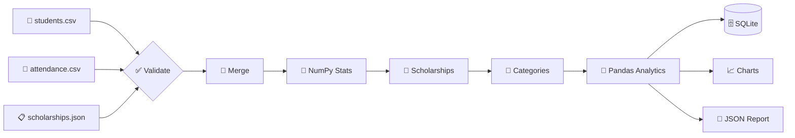
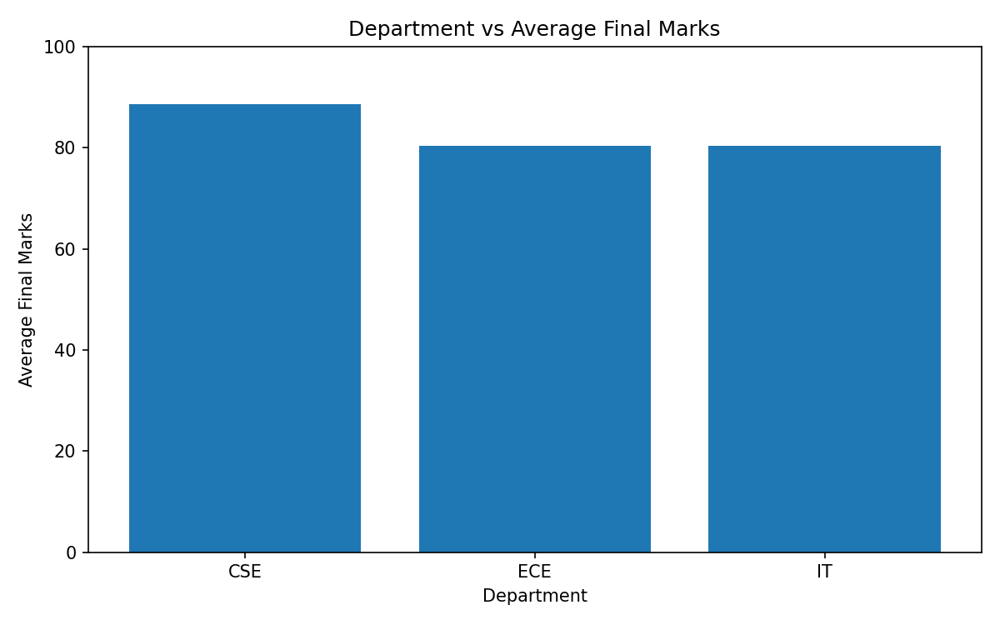
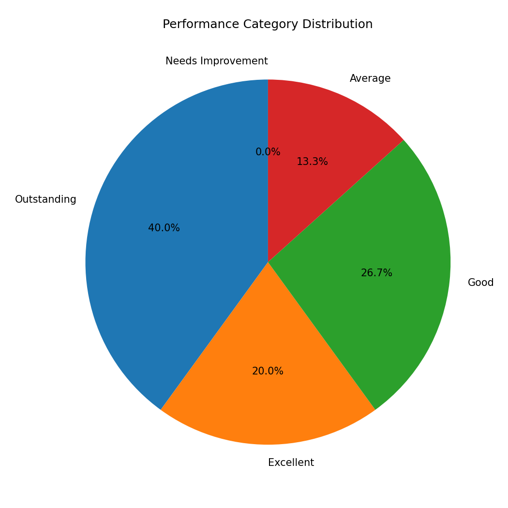

# Campus-Performance-Intelligence-System-
Mini Project during - HCL TRAINING. 
div align="center">
# 🎓 Campus Performance Intelligence System
 
### *Turning raw student data into scholarships, insights, and decisions* 📊
 


 
</div>
---
 
## 📖 About the Project
 
The **Campus Performance Intelligence System** is an end-to-end data pipeline that analyzes student academic performance. It merges student records with attendance data, applies **department-specific scholarship rules**, classifies performance levels, stores results in a **SQLite database**, generates **visual charts**, and produces a **management-ready JSON report**, all with a single command. 🚀
 
---
 
## ✨ Key Features
 
| | Feature | Description |
|---|---|---|
| ✅ | **Data Validation** | Checks required columns, scholarship rule structure, and duplicate student IDs |
| 🔗 | **Smart Merge** | Joins students and attendance with a validated one-to-one merge and missing-record detection |
| 🧮 | **NumPy Statistics** | Mean, median, standard deviation, min, and max for marks, plus mean attendance |
| 🎁 | **Scholarship Engine** | Applies per-department rules for minimum marks, minimum attendance, and bonus marks |
| 🏅 | **Performance Categories** | Classifies students from *Outstanding* to *Needs Improvement* |
| 🐼 | **Pandas Analytics** | Top 5 students, department and city averages, best department, and more |
| 🗄️ | **SQLite Storage** | Saves processed data and runs SQL analytical queries |
| 📈 | **Visualizations** | Bar chart and pie chart saved as PNG images |
| 📝 | **Management Report** | Auto-generated JSON summary for decision makers |
 
---
 
## 🛠️ Tech Stack
 
- 🐍 **Python 3**
- 🐼 **Pandas** for data manipulation and analytics
- 🔢 **NumPy** for statistical analysis
- 📉 **Matplotlib** for charts
- 🗃️ **SQLite3** for database storage and SQL queries
- 📦 **JSON / CSV** for input and output data
---
 
## 📂 Project Structure
 
```
📦 campus-performance-intelligence-system
 ┣ 📜 solution.py                     # Main pipeline script
 ┣ 📄 students.csv                    # Student records (input)
 ┣ 📄 attendance.csv                  # Attendance records (input)
 ┣ 📄 scholarships.json               # Scholarship rules (input)
 ┣ 🗄️ student_hackathon.db            # SQLite database (generated)
 ┣ 📊 department_performance.png      # Bar chart (generated)
 ┣ 🥧 performance_distribution.png    # Pie chart (generated)
 ┣ 📝 report.json                     # Management report (generated)
 ┗ 📘 README.md
```
 
---
 
## 🎯 Scholarship Rules
 
Eligibility depends on the student's department. A student must meet **both** the marks and attendance thresholds to receive bonus marks. 🏆
 
| 🏫 Department | 📚 Min. Marks | 📅 Min. Attendance | ➕ Bonus Marks |
|:---:|:---:|:---:|:---:|
| **CSE** | 80 | 90% | +5 |
| **IT** | 78 | 88% | +3 |
| **ECE** | 82 | 90% | +4 |
 
```json
{"department": "CSE", "bonus_marks": 5, "minimum_marks": 80, "minimum_attendance": 90}
```
 
---
 
## 🏅 Performance Categories
 
Students are classified using their **final marks** (marks + scholarship bonus):
 
| 🎖️ Category | 📏 Final Marks |
|:---|:---:|
| 🌟 Outstanding | ≥ 90 |
| 🔥 Excellent | 80 – 89 |
| 👍 Good | 70 – 79 |
| 📘 Average | 60 – 69 |
| ⚠️ Needs Improvement | < 60 |
 
---
 
## 🔄 Pipeline Workflow
 

 
### 📋 Tasks Covered
 
1. 🔍 **Data Inspection**: student count, departments, cities, sample records
2. 🔗 **Merge**: combine student and attendance data
3. 🧮 **NumPy Analysis**: statistical summary
4. 🎁 **Scholarship Eligibility**: rule-based bonus marks
5. 🏅 **Performance Classification**
6. 🐼 **Pandas Analytics**: rankings, groupings, `map()` and `filter()` usage
7. 🗄️ **SQLite Database**: store data and run SQL queries
8. 📈 **Visualization**: bar and pie charts
9. 📝 **Management Report**: JSON summary
---
 
## 📸 Results & Visualizations
 
### 📊 Department vs Average Final Marks
 

 
> 💡 **CSE** leads with the highest average final marks, while **ECE** and **IT** are close to each other at around 80.
 
### 🥧 Performance Category Distribution
 
<div align="center">

</div>
> 💡 **40%** of students are *Outstanding*, **20%** *Excellent*, **26.7%** *Good*, **13.3%** *Average*, and **0%** *Needs Improvement*.
 
---
 
## 📝 Sample Management Report
 
```json
{
    "total_students": 30,
    "average_marks": 81.03,
    "average_attendance": 89.27,
    "scholarship_students": 17,
    "top_student": "Meera Kapoor",
    "best_department": "CSE",
    "highest_attendance_student": "Meera Kapoor"
}
```
 
### 🔎 Key Insights
 
- 👥 **30** students analyzed
- 📚 Average marks: **81.03**
- 📅 Average attendance: **89.27%**
- 🎓 **17** students qualified for scholarships
- 🥇 Top student: **Meera Kapoor** (also highest attendance 🌟)
- 🏆 Best department: **CSE**
---
 
## 🗄️ Database Schema
 
**Table:** `student_performance`
 
| Column | Type | Description |
|---|---|---|
| `student_id` | INTEGER / TEXT | Unique student identifier |
| `name` | TEXT | Student name |
| `department` | TEXT | CSE / IT / ECE |
| `city` | TEXT | Student's city |
| `marks` | REAL | Original marks |
| `attendance` | REAL | Attendance percentage |
| `scholarship_status` | TEXT | Eligible / Not Eligible |
| `final_marks` | REAL | Marks after bonus |
| `performance` | TEXT | Performance category |
 
### 🔍 SQL Queries Included
 
```sql
-- 1️⃣ Scholarship-eligible students
SELECT student_id, name, department, final_marks, scholarship_status
FROM student_performance
WHERE scholarship_status = 'Eligible';
 
-- 2️⃣ Students with final marks above 85
SELECT student_id, name, department, final_marks
FROM student_performance
WHERE final_marks > 85
ORDER BY final_marks DESC;
 
-- 3️⃣ Department-wise average final marks
SELECT department, ROUND(AVG(final_marks), 2) AS average_final_marks
FROM student_performance
GROUP BY department
ORDER BY average_final_marks DESC;
```
 
---
 
## 🚀 Getting Started
 
### 1️⃣ Clone the repository
 
```bash
git clone https://github.com/<your-username>/campus-performance-intelligence-system.git
cd campus-performance-intelligence-system
```
 
### 2️⃣ Install dependencies
 
```bash
pip install pandas numpy matplotlib
```
 
### 3️⃣ Make sure input files are present
 
- `students.csv` with columns: `student_id, name, department, city, marks`
- `attendance.csv` with columns: `student_id, attendance`
- `scholarships.json`
### 4️⃣ Run the pipeline
 
```bash
python solution.py
```
 
### ✅ Generated outputs
 
- 🗄️ `student_hackathon.db`
- 📝 `report.json`
- 📊 `department_performance.png`
- 🥧 `performance_distribution.png`
---
 
## 🧠 Concepts Demonstrated
 
- 🔹 Data validation and error handling
- 🔹 Pandas merge with `validate="one_to_one"`
- 🔹 Row-wise logic with `apply()` and lambda functions
- 🔹 Functional programming with `map()` and `filter()`
- 🔹 GroupBy aggregations
- 🔹 SQL integration through `sqlite3` and `pd.read_sql_query`
- 🔹 Data visualization with Matplotlib
- 🔹 Config-driven business rules from JSON
---
 
## 🔮 Future Enhancements
 
- 🌐 Interactive dashboard with Streamlit or Plotly
- 📧 Automated email alerts for at-risk students
- 🤖 ML model to predict student performance
- 📅 Semester-wise trend analysis
- 🐳 Docker support
---
 
## 🤝 Contributing
 
Contributions, issues, and feature requests are welcome! 🎉
Feel free to fork the repo and open a pull request.
 
---
 
## 👤 Author
 
<div align="center">
### ⭐ If you found this project useful, give it a star! ⭐
 
*Made with ❤️ and Python 🐍*
 
</div>
 


